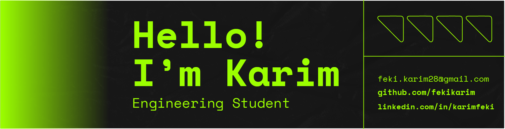

  

  
  

---

# 🎯 About Me

I am a **Computer Engineering student at ESPRIT University (Tunisia)** specializing in **Computer & Mobile Systems (SIM)**.

I design and develop **scalable, production-ready mobile, web, and desktop applications** using a strong engineering methodology grounded in:

- Software Architecture & System Design  
- Clean Code & Maintainability  
- UI/UX & Product Thinking  
- Performance Optimization  
- Agile & Team Collaboration  

With an **entrepreneurial and innovation-driven mindset**, I aim to build impactful digital products that combine technology, design, and business strategy.

---

# 🚀 Current Focus

- 🏗 Software Architecture & System Design  
- 📱 Native & Cross-Platform Mobile Development (Flutter, Kotlin, Swift)  
- 🌐 Modern Full-Stack Web Development (React, Next.js, Node.js, Spring Boot)  
- 🧠 DevOps & Scalable Backend Systems  
- 💼 Tech Entrepreneurship & Product Strategy  

---

# 🛠 Technology Stack

### 👨‍💻 Programming Languages

---

### 🌐 Frontend Development

---

### 🖥 Backend & Frameworks

---

### 📱 Mobile Development

---

### 🗄 Databases

---

### ⚙️ Tools & DevOps

---

# 💼 Professional Experience

## 🏢 Business Immersion Internship — STAR ASSURANCES (2025)

**Duration:** June 2025 – August 2025  
**Location:** La Goulette, Tunis (Hybrid)

Developed and deployed a **full-stack Challenge Management System** designed to gamify and optimize sales performance.

### Key Contributions:
- Built a **Flutter mobile application**
- Developed a secure **Node.js / Express.js backend**
- Designed RESTful APIs
- Integrated SQLite database
- Implemented role-based access control
- Created performance dashboards with real-time updates
- Applied Agile methodology and UML modeling

✅ Delivered a scalable, secure, and production-ready system that improved transparency, engagement, and operational efficiency.

---

## 🏢 Full-Stack Developer Intern — Tunisie Telecom (2023)

Developed a professional **full-stack e-commerce platform** using React.js.

- Improved UX and overall system performance
- Collaborated within a structured development team
- Delivered within strict deadlines
- Received official internship certification

---

# 🏆 Selected Projects & Achievements

## 🎮 The World Within
2D cultural diversity game  
🥈 **2nd Place — Game Design & Development Day 2023**

## 💼 HireUp
Recruitment & employment platform  
🏆 **Top 3 — Best Website Design & Development Day 2024**

## 🌱 Eco.net
Environmental awareness platform (Symfony + JavaFX)  
🏆 Selected for **Bal des Projets 2025**

## 📱 Tache-Lik
iOS & Android educational management platform  
🏆 **Top 1 Project — 4th Year University Class (4SIM1)**

---

# 👥 Leadership & Collaboration

- Core member of **Be.net Team**
- Led and contributed to multiple award-winning projects
- Mentored students in development and architecture concepts
- Strong experience in collaborative software engineering

---

# 📊 GitHub Analytics

  <!-- Stats Card -->
  

  <!-- Languages Card -->
  

  <!-- Streak Card -->
  

---

# 🎨 Design & Product Mindset

- UI/UX Design (User-Centered Methodology)
- Branding & Graphic Design
- Product Strategy Thinking
- Engineering + Business Integration

---

# 🌍 Connect With Me

---

### "Innovation distinguishes between a leader and a follower."  
— Steve Jobs  

**Let’s build impactful technology together.**

  

